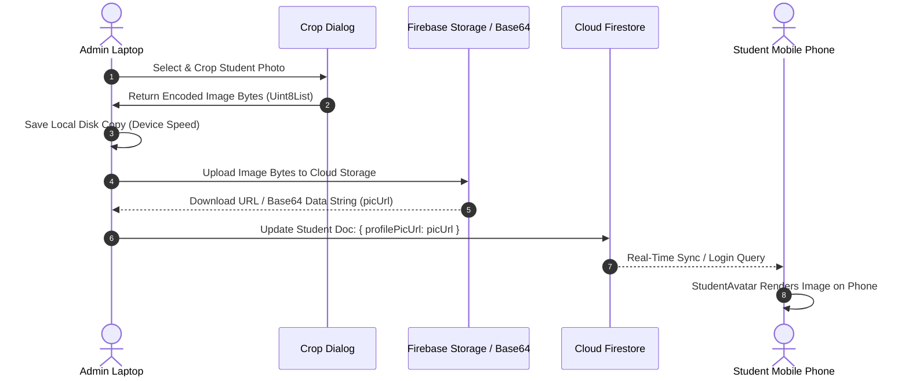

# Quaid Academy Student Image Storage & Sync Architecture

This document explains how student profile images are captured, stored, and synchronized across devices (laptops and mobile phones) in the Quaid Academy application ecosystem.

---

## 1. Overview: How Multi-Device Syncing Works

When an administrator adds or updates a student's picture on a laptop, **that picture is uploaded to the cloud and immediately displays on any mobile phone or tablet where the student logs in**.

---

## 2. The 3-Tier Image Architecture

To guarantee high speed and reliability across web, desktop, and mobile, the application uses a **3-tier image storage system**:

| Tier | Layer Name | Purpose & Location | Why It Works Across Devices |
| :--- | :--- | :--- | :--- |
| **Tier 1** | **Cloud Storage URL** | Uploaded to Firebase Storage (`https://firebasestorage.googleapis.com/...`) | Any phone with internet access fetches and displays the image via `CachedNetworkImage`. |
| **Tier 2** | **Base64 Data URI Fallback** | Stored directly inside the Firestore document (`data:image/jpeg;base64,...`) | If Firebase Storage is unconfigured or slow, the image data travels *inside* the Firestore document data to all phones. |
| **Tier 3** | **Local Disk Cache** | Saved locally on the device disk (`ImageUtils.saveImageLocally`) | Provides zero-latency, instant offline rendering on the administrator's local machine. |

---

## 3. Step-by-Step Technical Flow

### Step A: Selection & Cropping (Admin Dashboard)
1. The admin chooses a photo from the gallery or camera in `AddStudentScreen`, `EditStudentScreen`, or `StudentDetailScreen`.
2. `CropImageDialog` presents an interactive circle view.
3. When the admin clicks **CROP & SAVE**, `boundary.toImage(pixelRatio: 1.5)` converts the view into an optimized `Uint8List` byte array.

### Step B: Dual Upload & Synchronization
1. **Local Disk**: The app calls `ImageUtils.saveImageLocally(studentId, bytes)` to cache the image file on disk.
2. **Cloud Upload**: The app sends the bytes to Firebase Storage (`students/profile_<studentId>_<timestamp>.jpg`).
3. **Resilient Fallback**: If the storage upload times out or Firebase Storage is unconfigured, the app converts the cropped bytes into a `base64` Data String.
4. **Firestore Record**: The resulting URL or Data URI string is written to the `profilePicUrl` field in the Firestore `students` collection document.

### Step C: Mobile Rendering (`StudentAvatar` Widget)
When a student logs into their phone in `StudentDashboardScreen` or `StudentProfileScreen`:
1. The app fetches the student's Firestore document.
2. The unified `StudentAvatar` widget evaluates `student.profilePicUrl`:
   - **`http/https` URL**: Downloaded and cached on the phone using `CachedNetworkImage`.
   - **`data:image` / Base64**: Decoded in memory using `Image.memory`.
   - **Local File**: Loaded from local disk if available.
   - **Fallback**: Displays initials (e.g. "AH") or standard person icon.

---

## 4. Key Benefits

- **Instant Cross-Device Availability**: Photos added on the admin laptop sync automatically to student mobile phones.
- **Zero Loss Guarantee**: Base64 encoding ensures images are preserved in Firestore even if network storage has connection issues.
- **Fast Offline Performance**: Local disk caching prevents re-downloading images repeatedly.
